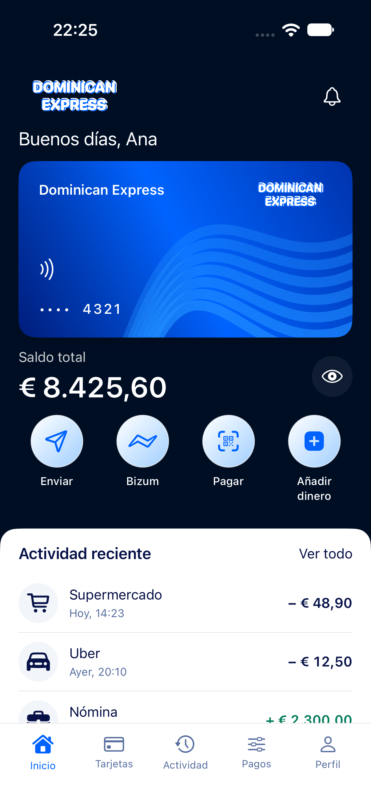
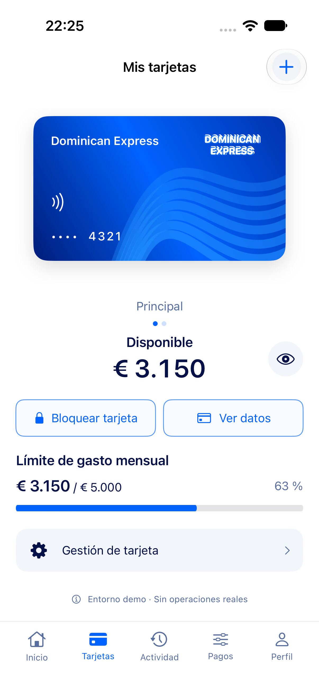

# Dominican Express

A digital bank built for the Advanced Databases course at Universidad Francisco
de Vitoria (UFV). The deliverable is **the database**: a complete banking
backend written in SurrealDB 3.2.4, with no application server in front of it.
The repository also holds a native iOS app (SwiftUI) that shows the product,
still on mock data.

## The database: start here

**[db/README.md](db/README.md)**: what it does, four commands to start it, and
every document.

In short: accounts, an append-only ledger, transfers and Bizum, cards,
per-customer permissions, an HTTP API, real-time fraud alerts with an
automatic proportional response, an audit trail and a time machine for
investigations, all inside SurrealDB. The fraud detector is tested on IBM's
public anti-money-laundering dataset, the schema runs on a three-node TiKV
cluster that survives a dead node, and every test is also run against code
broken on purpose.

```sh
curl -sSf https://install.surrealdb.com | sh -s -- --version 3.2.4 ~/.local/bin
git clone https://github.com/Dominican-Express/dominican-ios.git && cd dominican-ios
./db/demo/demo.sh up          # SurrealDB on disk, demo data loaded on first start
./db/demo/test_all.sh --quick # the 6 test suites: expect ALL PASSED
```

| Document | For |
|---|---|
| [db/INSTALL.md](db/INSTALL.md) | Installation on macOS, Linux and Windows |
| [db/DEMO.md](db/DEMO.md) | The demo step by step, with the output you should see |
| [db/FUNDAMENTALS.md](db/FUNDAMENTALS.md) | SurrealDB explained with this project |
| [db/DECISIONS.md](db/DECISIONS.md) | Every engineering decision and its evidence |
| [db/REFLECTION.md](db/REFLECTION.md) | Strengths, limitations, comparison |
| [db/DATASET.md](db/DATASET.md) | The detector on IBM's AML dataset |
| [db/CLUSTER.md](db/CLUSTER.md) | The schema on a 3-node TiKV cluster |
| [db/APP_INTEGRATION.md](db/APP_INTEGRATION.md) | How an app talks to the database |

## The iOS app

<p>
  
  
</p>

Native SwiftUI app (MVVM, async/await, Swift 6, iOS 26+) with the eight screens
of the design reference (`docs/design-reference.png`): home, cards, activity,
transfers and Bizum, shared account, insights and profile. It runs on mock
data with no network calls; payments are simulated and never change a
balance. Connecting it to the database means one new `BankRepository`
implementation; the contract is in [db/APP_INTEGRATION.md](db/APP_INTEGRATION.md).

Run it: install Xcode with the iOS 26 SDK or later, open
`DominicanExpress.xcodeproj`, choose the **DominicanExpress** scheme and a
simulator, and press **Cmd+R**. For a physical iPhone, set your team in
Signing & Capabilities. No dependencies, keys or backend.

Tests:

```sh
./scripts/test.sh                                   # 9 domain and view-model tests
./scripts/test-ui.sh <simulator-udid>               # 6 UI tests (xcrun simctl list devices available)
```

After adding files, regenerate the project with
`python3 scripts/generate_project.py`.

| Folder | Content |
|---|---|
| `Project/App`, `Project/Core` | Entry point and the shared observable `BankStore` |
| `Project/Features` | One module per screen: views, components, view models |
| `Project/Models`, `Project/Services` | Entities and the `BankRepository` contract |
| `Project/MockData` | Fixed demo snapshot behind an asynchronous repository |
| `Project/DesignSystem`, `Project/Utilities` | Palette, components, decimal money formatting |
| `Tests` | Swift Testing and XCUITest |

## Licence

The database code in `db/` is under the MIT licence ([db/LICENSE](db/LICENSE)).
The IBM data sample in `db/data/ibm-aml/` is under CDLA-Sharing-1.0, as its
source.
